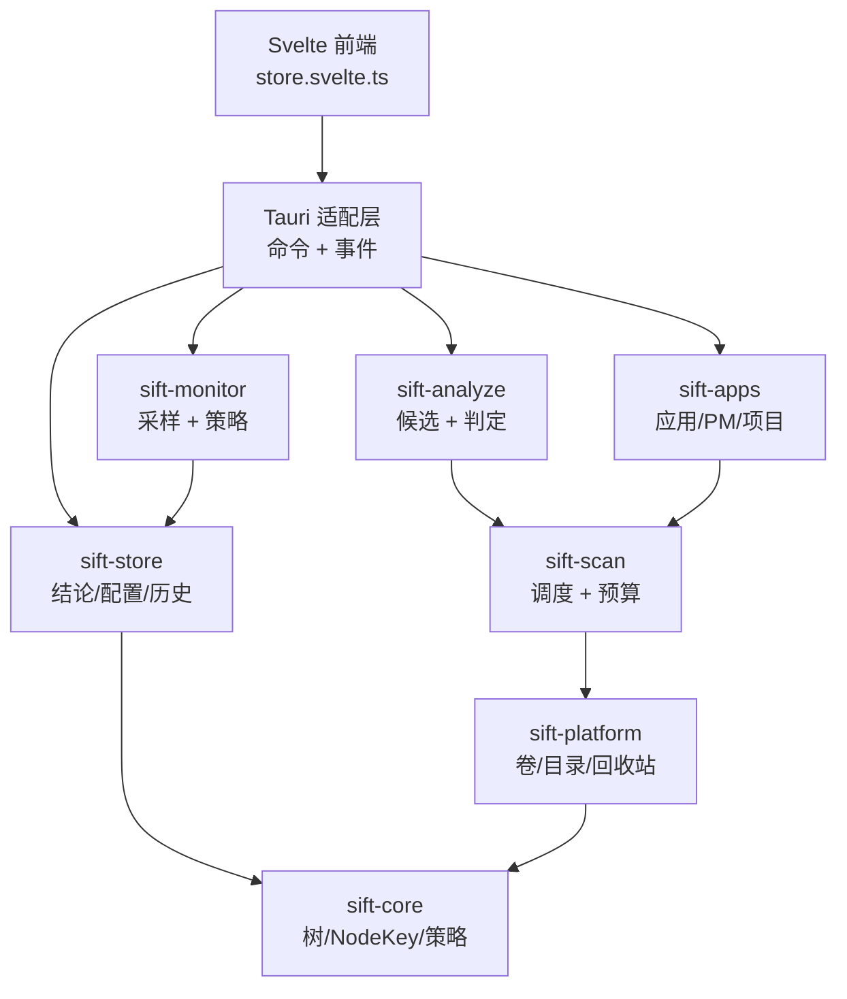
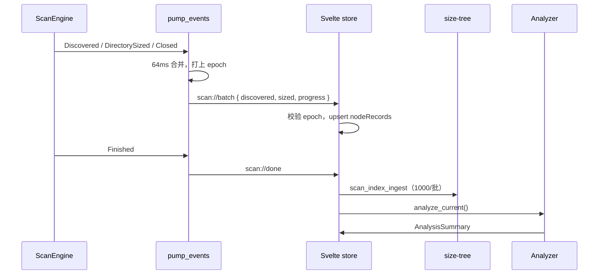
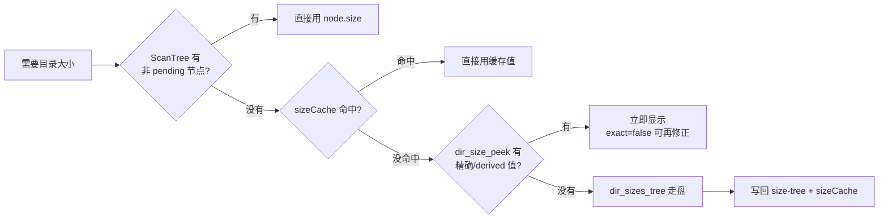
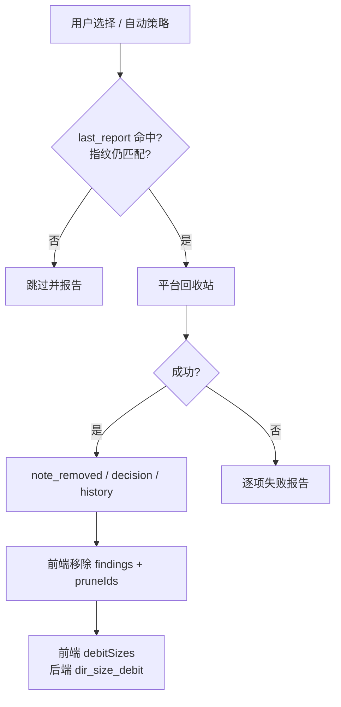

# 核心数据模型与数据流

> 本文回答两个问题：Sift 的核心框架是怎么设计的；现在每一类数据由谁产生、存在哪里、何时更新、何时失效、谁可以信任。

## 0. 一句话概括

**磁盘是最终事实；扫描树是会话事实；尺寸索引是跨会话的共享事实；`sift-store` 是结论与配置的事实；前端状态只是投影。**

所有性能优化都围绕“一次扫描，多处复用”；所有安全规则都围绕“结论带指纹，删除前重验”。

## 1. 设计方法

### 1.1 按能力分层，依赖单向向下

```
src-tauri  （命令、事件、Tauri 状态）
   │
sift-monitor  （后台采样 + 纯策略 + 可注入 Remover）
   │
sift-store    （结论/配置/历史/环境，原子持久化）
   │
sift-analyze  （候选提名 + 判定 + 路由 + 护栏 + 维护建议）
   │
sift-apps     （应用/包管理器/项目清单 + 卸载计划/隔离区）
   │
sift-scan     （调度、预算、事件流）
   │
sift-platform （卷、目录批量读、回收站、文件监听）
   │
sift-core     （arena 树、字节记账、NodeKey、策略、事件类型）
```

`src-tauri` 不写产品逻辑，只做命令注册、事件翻译和 Tauri 状态。



箭头表示依赖方向：上层可以调用下层，下层不认识上层。

### 1.2 事实源分级

| 级别 | 事实源 | 可信度 | 说明 |
|---|---|---|---|
| L0 | 磁盘 | 最终事实 | 任何缓存都可能在它之后过期 |
| L1 | `ScanTree` / 扫描事件 | 会话事实 | 一次扫描的目录结构、汇总大小、状态 |
| L2 | `Store` 文件夹索引 + `size-tree.json` | 跨会话共享事实 | 目录列表由 Store 持有；目录大小由尺寸索引复用 |
| L3 | `sift-store` 文档 | 结论/配置事实 | 判定、可清理清单、设置、历史、环境 |
| L4 | 前端 `store.svelte.ts` 状态 | 投影 | 为提高交互速度而存在的副本，可被重建 |

**规则：低级别可以修正高级别，高级别不能反向覆盖低级别。** 例如扫描结果可以更新尺寸索引；尺寸索引不能改变扫描树；前端缓存不能成为删除授权的依据。

### 1.3 读路径与写路径分离

- **写路径**：扫描引擎 → 批量事件 → 前端 upsert；分析 → `Store`；清理 → 回收站 + `Store` + 尺寸索引扣减。
- **读路径**：UI 只读前端状态；缺数据时才向 Rust 索引/磁盘请求。
- **缓存只加速读，不改变写。**

### 1.4 事件增量 + 批量合并

扫描不会为每个文件发一次 IPC。`pump_events` 把 64ms 窗口内的发现/尺寸/权限事件合并成一个 `scan://batch`，单批最多 2000 个节点 / 2000 个尺寸更新。前端用 `scanEpoch` 丢弃过期批次。

### 1.5 结论指纹化

`PathFingerprint { key, size, mtime_ms, is_dir }` 是判定复用的唯一键。任一分量变化，旧判定失效。删除前必须重新 stat 并比较指纹。

### 1.6 前端乐观更新 + 后端权威

清理、剪枝、尺寸扣减会先在前端立即生效，保证界面不卡；后端 `size-tree` 同步扣减，`Store` 记录结论。后端失败时前端会收到错误/事件，下一次分析或重新列目录会纠正。

### 1.7 有界、原子、可恢复

- 每份持久化文档有容量上限（verdicts 20k、cleanable 5k、history 200、routines 100、hints 200）。
- JSON 文档原子写；损坏文件归档为 `.corrupt`，启动用默认值并给出 warning。
- 扫描日志用 SQLite WAL，支持中断恢复。
- 应用卸载用隔离区 + manifest，可恢复。

## 2. 数据全景

| 数据 | 位置 | 生产者 | 主要消费者 | 更新时机 | 失效/边界 |
|---|---|---|---|---|---|
| `ScanTree` | 进程内存（`ScanManager.last_tree`） | `sift-scan` 引擎 | 分析、扫描事件 | 扫描时增量建树 | 新扫描替换；会话结束丢失 |
| 节点批次 `BatchUpdate` | Tauri 事件 `scan://batch` | `pump_events` | 前端 `handleBatch` | 每 64ms | `epoch` 不匹配即丢弃 |
| 前端节点索引 | `nodeRecords` / `pathToId` / `childIds` | `handleBatch` | Explorer、treemap、分析列表 | 扫描批次、剪枝 | 新扫描重置；删除时剪枝 |
| 尺寸树 | `size-tree.json` + 进程 `TREE` | 扫描 ingest、懒加载 walk、清理扣减 | `dir_size_peek`、`dir_sizes_tree` | 扫描完成、目录浏览、清理 | 手动 rescan、清理扣减、TTL 不适用（持久）；超过 64 MB 的 JSON 移到 `.oversized` 并重建 |
| 文件夹索引 | `sift-store::FolderIndex` 进程内存 | `list_dir_entries` 读取、Store 队列回填 | Explorer、`store_node` / `store_children` 调用方 | 列目录时 | 列表 5 分钟、尺寸 30 分钟 TTL；含父子边/大小/purpose；手动 rescan 清空；重启丢失（后续持久化） |
| Store 任务队列 | `FetchQueue` 进程内存 | Store miss/stale、列表发现的子目录 | List / ActiveSize / BackgroundSize 三个 lane | 列目录 miss、发现缺失尺寸 | 按路径+类型去重；可见列表 100、可见尺寸 80（active）、子目录 50、过期 10（background） |
| 前端尺寸镜像 | `src/lib/sizeCache.ts` 内存 Map | `sizesFor` / `seedSize` | Explorer、其他页面 | 读尺寸、扫描种子、清理扣减 | 30 分钟 TTL；800 条上限；重启丢失 |
| 判定缓存 | `verdicts.json` | `Store::record_analysis` | 下次分析 | 每次分析 | 指纹变化；容量 20k |
| 可清理清单 | `cleanable.json` | `Store::record_analysis` | 自动清理、监控、UI | 每次分析 | 仅 `Safe`；指纹变化；容量 5k |
| 决策日志 | `decisions.json` | 用户删除/保留、自动清理 | 习惯挖掘 | 每次清理/决策 | 容量 5k |
| 设置 | `settings.json` | 设置命令 | 扫描/分析/监控/UI | 用户修改 | schema 版本；损坏归档 |
| 历史 | `history.json` | 每次清理会话 | Home/Dashboard | 清理完成 | 容量 200 |
| 例行任务 | `routines.json` | 用户接受/保存 | 调度/监控 | 用户操作 | 容量 100 |
| 环境快照 | `environment.json` | `analyze_current`/`refresh_environment` | Dashboard、启动器、模型 prompt | 每次分析或手动刷新 | 5 分钟 TTL + 应用目录 dirty flag |
| 扫描日志 | `scan-journal.sqlite` | `SqliteScanJournal` | 崩溃恢复 | 扫描中 | 扫描完成/失败后清理 |
| 卸载 manifest | `Quarantine/<id>/manifest.json` | 卸载执行 | 恢复 | 执行卸载 | 用户清空隔离区后失效 |
| 前端临时状态 | `store.svelte.ts` | 事件/用户操作 | 各视图 | 随时 | 页面刷新/新扫描 |

## 3. 扫描数据流

```
start_scan
  │  选择卷、策略、恢复日志
  ▼
ScanEngine（协调线程 + 工作线程）
  │  ScanEvent: Discovered / DirectoryListed / DirectorySized / Closed / Adopted
  ▼
pump_events（64ms 合并，epoch=scan_id）
  │  scan://batch { epoch, discovered, sized, permissions, progress? }
  ▼
Svelte handleBatch
  │  epoch 校验
  ├─ nodeRecords / pathToId / childIds 增量 upsert
  ├─ sized 补丁：size / pending / status
  ├─ progress 更新
  └─ rebuildCurrentEntries()
  ▼
scan://done
  ├─ ingestScanTree()：目录大小写入 size-tree.json（1000/批）
  └─ runAnalysis()：分析当前树
```



### 3.1 启动与恢复

`ScanManager` 持有当前扫描控制、最后一次的 `ScanTree` 和 root。`start_scan_with` 选择卷、构造 `ScanPolicy`，用 `SqliteScanJournal` 支持中断恢复；`NodesAdopted` 把恢复节点作为 `discovered` 发出，`pending` 表示目录尚未闭合。

### 3.2 扫描中的状态

- `DirectoryListed` 发出该目录和直接子目录；子目录初始 `size` 可能为 0、`pending=true`。
- `DirectorySized` 发出汇总大小；`pending=false` 后前端才把它视为稳定值。
- `DirectoryClosed` 只发终态（`ok/denied/awaiting/estimated`），不改 size。
- 根节点由适配层先发一个 `parentId=null` 的节点，前端把它设为 `rootId/currentNodeId`。
- `Progress` 每 250ms 附着在批次上，只用于展示，不作为事实源。

### 3.3 扫描完成

`scan://done` 且未取消时：

1. 前端把 `nodeRecords` 中所有 `isDir && size>0` 的节点分批 `scan_index_ingest` 到后端尺寸树。后端把它们标记为 `exact=true`，并建立 parent/child 边。
2. 调用 `runAnalysis()`，把分析结论写入 `Store`。
3. `analysedScan` 防止同一次扫描重复分析。

### 3.4 权限刷新

`resolve_permission` 之后，重新走被授权目录，事件以 `scan://refreshed` 结束；前端 `handleRefreshed` 重建当前目录并重新分析。尺寸通过普通的 `sized` 批次更新。

### 3.5 外部删除

`watch_fs` 监听浏览根；`FsEvent::Deleted` 变成 `fs://deleted { id, path }`，前端 `pruneIds` 剪掉节点并重算祖先大小。

**已对齐部分**：`fs://deleted` 会 invalidate 被删路径及其父目录的 Store 文件夹索引，下一次列目录会重新抓取。**已知缺口**：`size-tree` 的 `sizes` 仍未同步；`dir_size_peek` 可能返回旧值。见第 13 节。

## 4. 尺寸与目录索引数据流

### 4.1 后端尺寸树

`src-tauri/src/size_tree.rs` 是跨会话的共享索引：

- `sizes: path -> bytes`
- `exact: path -> bool`（完整走盘为 true；由子目录汇总为 false）
- `parents` / `children`：向上重算

目录列表不在尺寸树里。`FolderIndex` 由 `Store` 持有，`list_dir_entries` 只读 Store；
缺失/过期的目录交给 `FetchQueue`，OS 读取完成后写回 Store、递增 revision 并发出
`store://folders-changed`。

更新入口：

| 入口 | 来源 | 标记 |
|---|---|---|
| `scan_index_ingest` | 扫描完成的前端树 | `exact=true` |
| `record_scan_dir` | 扫描引擎闭合目录 | `exact=true` |
| `dir_sizes_tree` | 懒加载走盘 | `exact = 完整走盘` |
| `dir_size_debit` | 清理后扣减 | 保持原 exact/derived |
| `dir_sizes_clear` | 手动重扫 | 清空整棵树 |

`record` 写入大小后，`recompute_ancestors` 用子目录之和更新祖先。
**精确父目录不会被覆盖**（防止父目录直接文件的字节被丢掉）。

### 4.2 Store 文件夹索引与抓取队列

`list_dir_entries` 不再直接 `read_dir`，而是：

1. 向 `Store::folders().list(path)` 查询；
2. `Fresh` → 直接返回；`Stale` → 返回旧列表并标记 `pending`；
3. `Missing` → 返回空列表并标记 `pending`；
4. `Stale` / `Missing` 都调用 `FetchQueue.enqueue_list(path)`；队列按路径+类型去重；
5. List worker 只执行 `read_dir`，`FolderIndex::apply` 写入列表并递增 revision；
6. Tauri 广播 `store://folders-changed`；前端刷新当前目录；
7. 列表中的每个目录若 Store 没有 fresh 尺寸，则入队 `Size` 任务；
8. Size worker 做有界 walk，`FolderIndex::apply_size` 写入并广播 `store://sizes-changed`；
9. 前端直接更新对应行与父目录总数，不整页重载。
10. 列表 5 分钟、尺寸 30 分钟：过期值先返回（stale），同时低优先级刷新。

前端 `dirCache.listingFor` 只做并发去重；返回时把目录 `size` 归零，交给尺寸解析层填充。
`dir_listing_clear` 已删除；手动刷新调用 `folders_clear` 清空 Store 索引。



### 4.3 前端尺寸解析优先级

`openExplorer` → `knownSize(path)`：

```
扫描树节点（非 pending、status=ok|estimated、size>0）
        │ 命中
        ▼
前端 sizeCache（30 分钟 TTL）
        │ 命中
        ▼
后端 dir_size_peek（sizes 中的精确或 derived 值）
        │ 命中
        ▼
dir_sizes_tree 懒加载（走盘，写回后端 + 前端）
```

细节：

- `treeSize` 只返回非 pending 的 `ok/estimated` 目录节点；`size=0` 不直接当作已知值。
- `sizeCache.sizesFor` 先读前端缓存；miss 时 `dirSizePeek` 的 derived 值也接受（`exact=false`），避免每次返回父目录都重新走盘；未知/0 才 `dirSizesTree`。
- `openExplorer` 把扫描得到的大小 `seedSize` 到共享缓存，返回父目录时不再依赖扫描节点仍然存在。
- 清理时前端 `debitSizes` 扣减镜像，后端 `dir_size_debit` 扣减权威树；两边都更新。
- 手动 `refreshExplorer(true)` 清空前端 + Store 文件夹索引，下一次查询变成 miss 并进入抓取队列。

### 4.4 为什么分 exact / derived

- `exact=true`：完整走盘得到的值，可直接复用；
- `exact=false`：由已知子目录相加得到，能立即显示，但可能缺少父目录直接文件的字节；
- `dir_size_peek.partial` 目前等价于 `!exact`，只表示“不是完整走盘”，不代表“权限失败”。

## 5. 分析数据流

```
ScanTree（会话）
  │ 目录 pass：规则按名称/路径提名
  │ 文件 pass：枚举少量目录（下载/桌面/...）得到文件候选
  ▼
Candidate { kind, safety, fingerprint, evidence, nomination }
  │
  ├─ RuleAdjudicator（离线、确定性）
  └─ RoutingAdjudicator（只把可送模型的家族发给远程）
        │
        ▼
Verdict { safety, confidence, reason, impact, source }
  │
  ▼
AnalysisReport
  ├─ items（候选 + 判定）
  ├─ source_counts / unjudged
  └─ maintenance（远程模型可选）
  │
  ├─ record_analysis：verdicts.json + cleanable.json
  ├─ record_environment：environment.json
  └─ last_report（内存，供清理守卫）
```

### 5.1 候选生成

- **目录 pass**：遍历 `ScanTree`，按名称/路径规则提名 `node_modules`、`target`、`DerivedData`、缓存、日志、回收站等。
- **文件 pass**：只枚举有限目录（Downloads、Desktop、Documents 等），找安装包、压缩包、长期未动的大文件、同名同大小重复。
- 候选的 `safety` 来自本地规则，是“提名结论”；模型只能确认或削弱。

### 5.2 判定与路由

- `RuleAdjudicator` 复述候选自带的 `Nomination`，不重新推导规则。
- `RoutingAdjudicator` 只把 `must_model_adjudicate` 的家族发送给远程；结构性家族（缓存、构建产物、回收站）本地判定。
- 远程 `Safe` 必须同时满足：家族允许、全局开关、置信度 ≥ 阈值；否则降级 `Review`。
- 模型输出缺失/畸形/失败 → `Review`（`fallback`），永远不产生 `Safe`。
- 环境上下文以脱敏形式进入 prompt；模型返回的 `maintenance` 只进入 `Proposed` 提示。

### 5.3 持久化

`Store::record_analysis(report)`：

1. 每个 item 的 `fingerprint -> verdict` 写入 `verdicts.json`；
2. 只有 `Safe` 进入 `cleanable.json`；`Review` 留在 verdict 缓存，作为“问过但未授权”的记录；
3. `cleanable` 的 `approved_for_auto` 逐条保留；fingerprint 变化或降级会移除；
4. `last_report` 保存路径 → 判定/大小/kind，供清理时做“这个路径是否属于本次分析”的守卫。

### 5.4 结论复用

- `VerdictTable.lookup(fingerprint)` 只复用完全匹配的记录；size/mtime/type 任一变化都 miss。
- `cleanable` 按 `NodeKey` 去重；`times_seen` 记录复确认次数。
- 用户 dismiss 的 finding 存在 `settings.monitor.dismissed_findings`，下一次分析前过滤。

## 6. 清理数据流

```
用户选择 / 自动策略
  │
  ▼
clean_paths(paths) / run_routine / monitor auto-clean
  │
  ├─ 对照 last_report：路径必须属于最近分析
  ├─ 重新 stat：fingerprint 必须仍然匹配
  ├─ 平台 trash（可取消）
  ▼
per-item results
  │
  ├─ Store.note_removed / record_decision / note_cleanup_session
  ├─ 前端：findings 移除、pruneIds、祖先大小扣减
  └─ 前端 + 后端尺寸索引扣减
```



### 6.1 交互式清理

1. 前端 `clean()` 取 `candidates`（选中项），构造路径列表。
2. 后端 `perform_cleanup_with` 逐个核对 `last_report` 与最新 fingerprint；不匹配则不删。
3. 删除结果逐项返回 `{ path, ok, cancelled, error }`。
4. 成功项：`note_removed`（离开 cleanable、进入 decision）、`note_cleanup_session`（history）。
5. 前端：`findings` 过滤、`pruneIds` 剪树、文件/目录祖先大小扣减、`dirSizeDebit` 更新后端、刷新卷。

### 6.2 自动清理

`Monitor` 采样 → `policy::evaluate` 纯函数 → 只选择 `Safe + approved_for_auto + fingerprint 匹配 + home_only` 的条目 → `Remover`（系统回收站）→ `note_removed` / `note_cleanup_session`。阈值、冷却、单批上限都在 `MonitorSettings`。

### 6.3 目录 vs 文件

- 扫描树只有目录节点；删除**目录**时，`pruneIds` 按子树总大小扣减祖先。
- 删除**文件**时，前端 `debitFileFromAncestors` 按文件大小逐级扣减；后端 `dir_size_debit` 同样逐级扣减。
- 避免重复：被删除目录内的文件不再单独扣减。

### 6.4 已知缺口

- 后端 `ScanTree` 不随清理更新（清理只更新前端树、`size-tree` 和 `Store`）。如果清理后立即调用 `analyze_current`，它仍可能看到已删除路径，直到重新扫描或刷新。
- 外部删除会失效 Store 文件夹索引，但不同步 `size-tree` 的尺寸。

## 7. 环境、应用与包管理器数据流

```
ScanManager.last_root + home
  │
  ▼
sift_apps::detect
  ├─ macOS: /Applications + ~/Applications Info.plist
  ├─ Linux: .desktop / flatpak
  ├─ Windows: registry uninstall keys
  ├─ package managers: brew/npm/pnpm/... + version
  └─ projects: manifest + lockfile
  ▼
ScanContext { apps, package_managers, projects, ... }
  ├─ prompt 环境上下文（脱敏、截断）
  ├─ sift_apps::hints_for → MaintenanceHint
  └─ Store::record_environment → environment.json
```

更新规则：

- 分析时如果距上次 `updated_at_ms` < 5 分钟、root 相同、且 `environment_dirty=false`，直接复用；
- `apps::start_environment_watch` 监听应用目录，变化置 dirty；下一次分析强制重建；
- `refresh_environment` 手动强制刷新；
- hints 合并：已验证/已拒绝状态跨扫描保留，消失的 `Proposed` 变 `Stale`；
- 模型 `maintenance` 合并进同一 subject/action；模型只提供 reason/impact，不能改处置；
- 卸载计划：约定路径 + Homebrew zap + 共享检测；执行后写入隔离区 manifest，恢复按 manifest 逆序。

## 8. 持久化地图

```
~/Library/Application Support/Sift/            (macOS; 其他平台对应 data_dir)
├── verdicts.json         判定缓存（指纹 -> verdict）
├── cleanable.json        可清理清单（仅 Safe）
├── decisions.json        用户/自动决策日志
├── settings.json         设置（无凭据）
├── history.json          清理历史
├── routines.json         例行任务
├── environment.json      应用/包管理器/项目 + 维护建议
├── scan-journal.sqlite   可恢复扫描日志（WAL）
├── size-tree.json        目录大小（不再存目录列表）
├── Quarantine/<id>/      卸载隔离区（manifest + payload）
└── *.corrupt / *.bak     损坏文档归档
```

### 8.1 写入模型

| 文档 | 写入 | 一致性 |
|---|---|---|
| JSON 文档 | `write_document` 原子写 | 旧文件或新文件，不会截断 |
| `scan-journal.sqlite` | 后台 writer + 事务 | WAL，读请求同步 |
| `size-tree.json` | 1500ms 防抖整树写 | 非原子；崩溃可能丢最近更新 |
| Quarantine manifest | `std::fs::write` | 非原子；先移动 payload 再写 manifest 有窗口 |

### 8.2 加载模型

- JSON 损坏 → 归档 `.corrupt`，用默认值，`StoreWarning` 交给 UI；
- schema 版本不符 → 归档；
- `size-tree.json` 损坏 → `TreeData::default()`，静默重建；
- SQLite schema 版本高于当前二进制 → 拒绝使用，避免列不匹配。

## 9. 一致性与不变量

1. **只有 `Safe` 进入 `cleanable`**；`Review` 只存在于 verdict 缓存。
2. **删除必须同时满足**：`Safe`、`approved_for_auto`、fingerprint 仍匹配、`home_only` 边界、置信度阈值。
3. **批次 epoch 单调**：旧扫描的迟到批次被丢弃，不能重建新树。
4. **尺寸优先级**：扫描树 > 前端缓存 > 后端 derived > 走盘；精确值不被 derived 覆盖。
5. **一次扣减只发生一次**：目录子树与文件不重复扣；前后端各扣一次但语义独立。
6. **Store 单锁**：一份分析、清单、决策、设置的一致快照；避免交叉更新漂移。
7. **不存凭据**：设置只存环境变量名。
8. **模型不能单独授权删除**：`sanitize_model_verdict` 是唯一入口。
9. **环境上下文脱敏**：真实 home 路径、文件内容不进入 prompt。
10. **前端不是删除授权源**：清理命令必须回后端对照 `last_report` 和指纹。

## 10. 缓存与失效矩阵

| 缓存 | 键 | TTL | 失效/更新 |
|---|---|---|---|
| 扫描树 | session | 会话 | 新扫描替换 |
| 前端节点索引 | NodeKey/path | 会话 | 批次 upsert、`pruneIds` |
| 后端尺寸树 | path | 持久 | 扫描 ingest、走盘、扣减、手动 clear |
| Store 文件夹索引 | requested path | 5 分钟 | 手动 refresh / `folders_clear`；miss 交给 FetchQueue |
| Store 目录尺寸 | path | 30 分钟 | Size 任务回填；过期先返回再刷新 |
| 前端尺寸镜像 | path | 30 分钟 | `sizesFor`、`seedSize`、`debitSizes`、`clearSizeCache` |
| 判定缓存 | fingerprint | 持久 | 指纹变化、容量淘汰 |
| 可清理清单 | NodeKey | 持久 | 每次分析 upsert、审批、删除 |
| 环境快照 | roots | 5 分钟 | dirty flag、手动 refresh |
| AI 配置/密钥名 | profile | 持久 | 设置命令 |

## 11. 并发、线程与锁

| 组件 | 线程模型 | 锁 |
|---|---|---|
| `sift-scan` 协调者 | 单线程独占 `ScanTree` | 外层 `Mutex` 供 UI 读 |
| 工作线程 | N 个，只读目录 | 不碰树 |
| Tauri `ScanManager` | 命令线程 + pump 线程 | `Mutex<Option<ScanTree>>` |
| `size_tree` | 命令/后台/懒加载 | 全局 `Mutex<TreeData>`，`try_lock` 读、`lock` 写 |
| `Store` | 任意线程 | 单 `Mutex<Inner>` + `AtomicBool dirty` |
| 前端 | 单 JS 线程 | 无锁，靠事件顺序/epoch |
| 监控 | 独立线程 | 通道 + `AtomicBool` |

### 11.1 为什么尺寸树用 `try_lock`

目录列表是 UI 热路径；Store 的 `FolderIndex` 用独立短锁，只有读写列表时持有，不参与扫描/flush 的尺寸树锁。`dir_size_peek` 对尺寸树用 `try_lock`，拿不到就返回 miss/partial；列表 miss 则进入 FetchQueue，不在 Tauri 命令里阻塞走盘。

## 12. 失败与降级

| 失败 | 行为 |
|---|---|
| 扫描目录无权限 | 继续扫描其余部分；`denied` 状态；总数仍计入 |
| 前端收到旧 epoch 批次 | 丢弃 |
| 尺寸树损坏 | 用空树重建；下次扫描/浏览填充 |
| 尺寸索引锁不可用 | `peek` 返回 partial；Store 有 fresh 尺寸时优先复用，否则走盘 |
| 走盘被权限挡住 | `partial=true`，保留已知值，不冻结 |
| Store JSON 损坏 | 归档 + 默认值 + warning |
| 模型失败/超时 | 规则判定保留；候选变 `Review` |
| 清理中途失败 | 逐项报告；成功项已入库；失败项留在清单 |
| 环境 inventory 超时/权限 | 空上下文或旧快照，分析继续 |
| 卸载移动失败 | 返回错误；manifest 只含已移动项 |

## 13. 已知缺口与改进建议

以下是当前实现里**尚未闭环**的数据一致性点，按优先级排列：

1. **外部删除不同步尺寸索引**：`fs://deleted` 现在会 invalidate Store 文件夹索引，但 `size-tree` 的 `sizes` 仍未更新。建议增加 `size_tree_remove(path)`，或让 `pruneIds` 对后端发 `dir_size_debit`。
2. **清理后 `ScanTree` 仍是旧快照**：`clean_paths` 不修改 `ScanManager.last_tree`。若清理后立即 `analyze_current`，可能重新看到已删除路径。建议在清理成功后对树做 prune，或让前端在清理后触发一次轻量重扫。
3. **`dir_size_debit` 签名已修复**：前端发 `{ items }`，后端现在接收批量 `SizeDebitItem`；此前单参数版本会让扣减静默失败。建议加一个 IPC 集成测试。
4. **`Store` 文档注释过时**：`sift-store/src/lib.rs` 仍写“四份文档”，实际有 verdicts/cleanable/decisions/settings/history/routines/environment。应更新注释或生成数据字典。
5. **`size-tree.json` 无 schema 版本、非原子写**：崩溃可能丢失最近 1.5s 的尺寸更新；当前超过 64 MB 会移到 `.oversized` 并重建，避免启动阻塞。长期应换成 SQLite/分片索引。
6. **空目录不进入尺寸树**：`scan_index_ingest`/`record_scan_dir` 只记录 `size>0`；空目录在 `peek` 返回 partial，触发走盘。建议记录 `exact=true,size=0`。
7. **前端尺寸缓存不持久**：`sizeCache` 重启后清空，冷启动依赖后端 `size-tree`；目前可接受，但可考虑启动时 hydrate 常用路径。
8. **listing TTL 与尺寸 TTL 不一致**：列表 5 分钟、尺寸 30 分钟；外部变化后两者可能不同步。建议统一失效策略或让 listing 命中时校验 mtime。
9. **环境 `last_validated_ms` 使用旧 `updated_at_ms`**：`set_status` 记录的是上一次快照时间，不是当前时间；建议传入 now。
10. **模型 maintenance 仅远程**：本地规则/模拟判定器不产生；若离线也要建议，需要本地规则生成。
11. **Windows/Linux inventory 未在真实系统验证**：CI 只编译/测试，数据字段可能与真实注册表/desktop 条目有差异。

## 14. 新数据接入清单

新增一类数据时，必须回答：

1. **事实源**：它来自磁盘、扫描、用户还是模型？
2. **生产时机**：谁在什么时候写？
3. **存储位置**：内存 / JSON / SQLite / 外部？
4. **读取优先级**：与现有缓存谁优先？
5. **失效条件**：时间、指纹、版本、手动刷新？
6. **一致性**：是否需要原子写、版本号、容量上限？
7. **安全边界**：是否参与删除授权？是否可进入 prompt？
8. **失败降级**：读不到/写失败时 UI 怎么办？
9. **测试**：缓存命中/失效、并发、损坏恢复、边界路径。

## 15. 相关文档

- [架构地图（可视化）](architecture-atlas.html)——分层栈、五条数据流、事实源与缓存矩阵的单页视图
- [Store 中心架构：已落地部分与剩余边界](store-centric.md)——列表读模型、抓取队列、订阅与下一步
- [架构总览](overview.md)
- [应用卸载与数据沉淀](app-uninstall.md)
- [包管理器知识沉淀](package-manager-knowledge.md)
- [扫描时环境上下文](scan-context.md)
