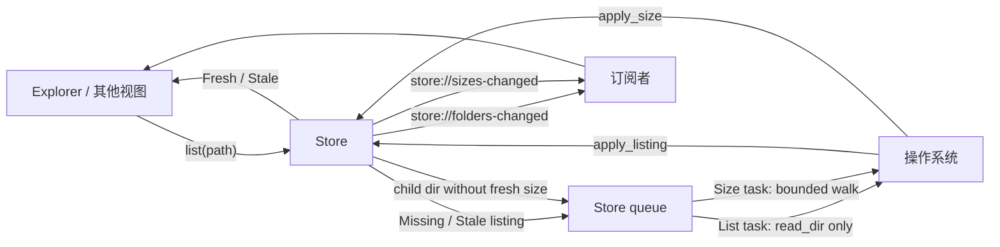

# Store 中心架构：已落地部分与剩余边界

目标模型：**Store 是文件列表与业务数据的唯一读模型**。视图不直接读磁盘；
Store 缺失的数据进入扫描/抓取队列，由 OS 侧填充回 Store；任何业务数据都通过
Store 的 revision 订阅变化。

## 1. 目标数据流

关键规则：

1. 读列表只经过 `Store`；命令层不调用 `read_dir`。
2. 列表缺失返回 `Missing + pending`，不阻塞命令；抓取队列异步填充。
3. 同一路径同时只有一个抓取任务；完成后递增 revision 并广播。
4. 订阅者用 revision/路径过滤，只刷新受影响的视图。
5. 删除/清理前仍必须重新验证 `last_report` 与指纹；Store 读模型不是删除授权。

## 2. 当前实现

| 组件 | 位置 | 职责 |
|---|---|---|
| `FolderIndex` | `crates/sift-store/src/folders.rs` | Store 持有的目录列表读模型；`Fresh` / `Stale` / `Missing`，5 分钟 TTL，revision + mpsc 订阅 |
| `Store::folders()` | `crates/sift-store/src/store.rs` | 暴露同一个 `FolderIndex` 给所有调用方 |
| `FetchQueue` | `src-tauri/src/fetch_queue.rs` | 按路径+任务类型去重；List 与 Size 分开的 worker 池；列表先返回，尺寸后台补；emit folders/sizes 两个 revision |
| `list_dir_entries` | `src-tauri/src/explorer.rs` | 只查 Store；miss/stale 入队并返回 `pending`；不再 `read_dir` |
| `read_entries` | `src-tauri/src/explorer.rs` | 仅供抓取队列调用的原始 OS 读取 |
| `folders_clear` | `src-tauri/src/explorer.rs` | 手动刷新时清空 Store 列表，下一次读取变 miss |
| 前端 `onFoldersChanged` / `onSizesChanged` | `src/lib/ipc.ts`、`store.svelte.ts` | 列表 revision 触发重新查询；尺寸 revision 直接更新对应行和总数，不整页重载 |

目录列表已从 `size_tree.rs` 移除；`size-tree.json` 只作为尺寸兼容镜像，不再存 `listings`。
Store 自己的尺寸记录有 30 分钟 TTL：过期值先返回并标记 stale，同时以低优先级入队刷新；
列表 5 分钟 TTL，过期值同样先返回再刷新。可见目录的尺寸任务优先级 80，列表发现的子目录 50，
过期刷新 10，列表任务使用独立 worker，永不被长尺寸 walk 阻塞。

## 3. 尚未对齐的部分

这部分是下一步，不应被当前实现掩盖：

1. **`ScanTree` 仍由 `ScanManager` 独占**：扫描结果先进 `ScanTree`，再由前端 ingest 到 Store 的尺寸索引；目标应让 Store 直接持有树/列表，扫描引擎只生产批次。
2. **扫描队列还不是公共服务**：`FetchQueue` 只处理目录列表；`ScanEngine` 的 `BinaryHeap` 仍是内部队列，外部无法把“缺失子目录”作为扫描任务加入。
3. **尺寸索引还有兼容镜像**：Store 已持有 `size/exact` 并作为读路径，但 `size-tree.json` 仍被部分旧功能写入；目标应彻底移除该镜像。
4. **业务数据没有统一订阅**：`verdicts/cleanable/settings/history` 仍在 `Store` 内，但没有 revision/event bus；只有文件夹索引有 `FolderChange`。
5. **文件夹索引不持久化**：重启后为空，靠重新抓取；目标应持久化快照/增量。
6. **外部删除只失效了文件夹索引**：`fs://deleted` 现在会 invalidate Store 的对应目录列表，但 `size-tree` 的 `sizes` 仍未同步。
7. **大 `size-tree.json` 的边界**：超过 64 MB 会移到 `.oversized` 并重建，避免 677 MB JSON 在首屏阻塞；长期应迁移到 SQLite/分片索引。

## 4. 验收基线

- `cargo test --workspace`：通过。
- `pnpm check` / `pnpm build`：通过。
- 原生 App 实测：首次打开 Explorer 先显示 loading，抓取完成后列出 127 个条目；无 toast、无卡死。
- `architecture-atlas.html` 的 `check_design`：1280×900 / 390×844 无问题。
